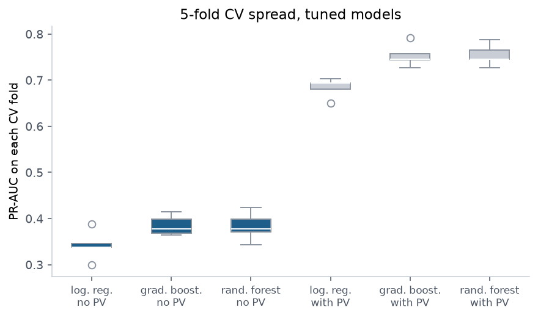
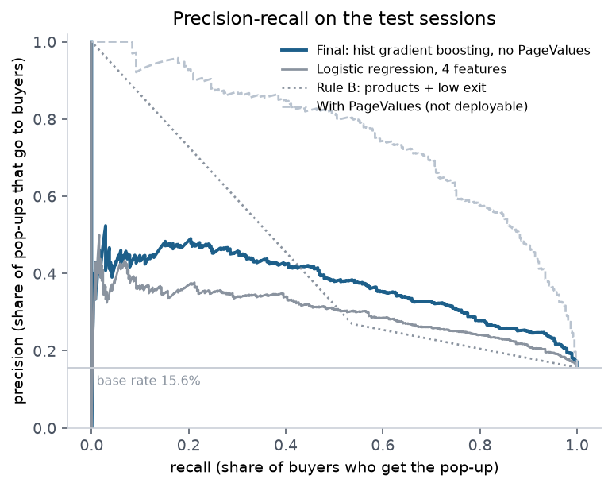
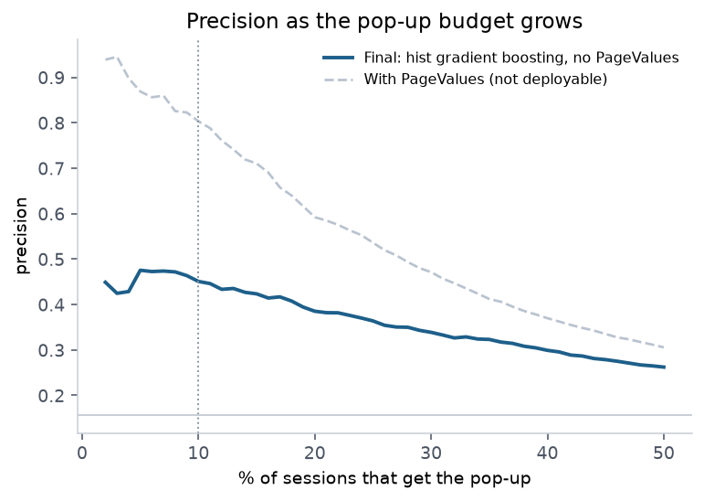
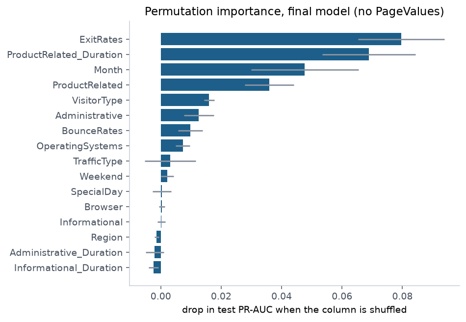
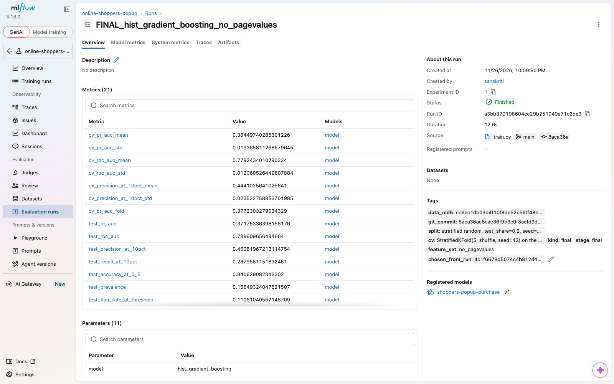
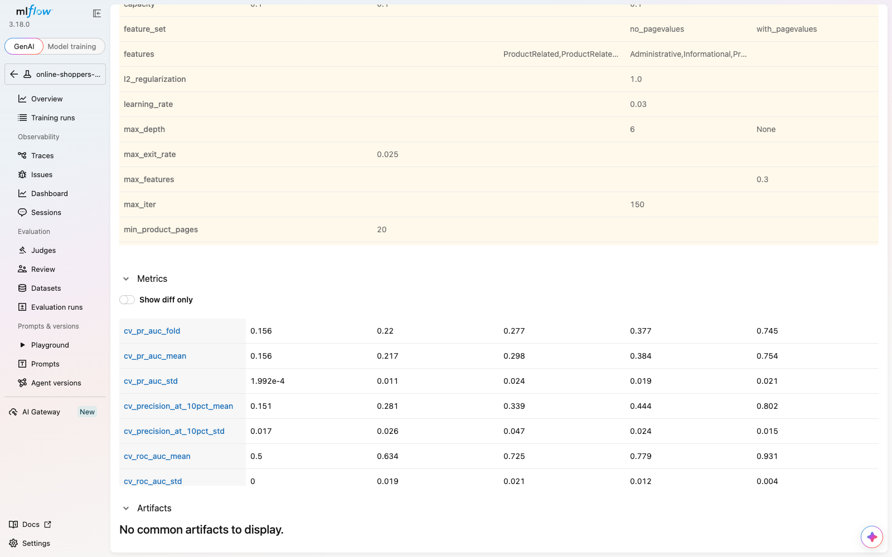
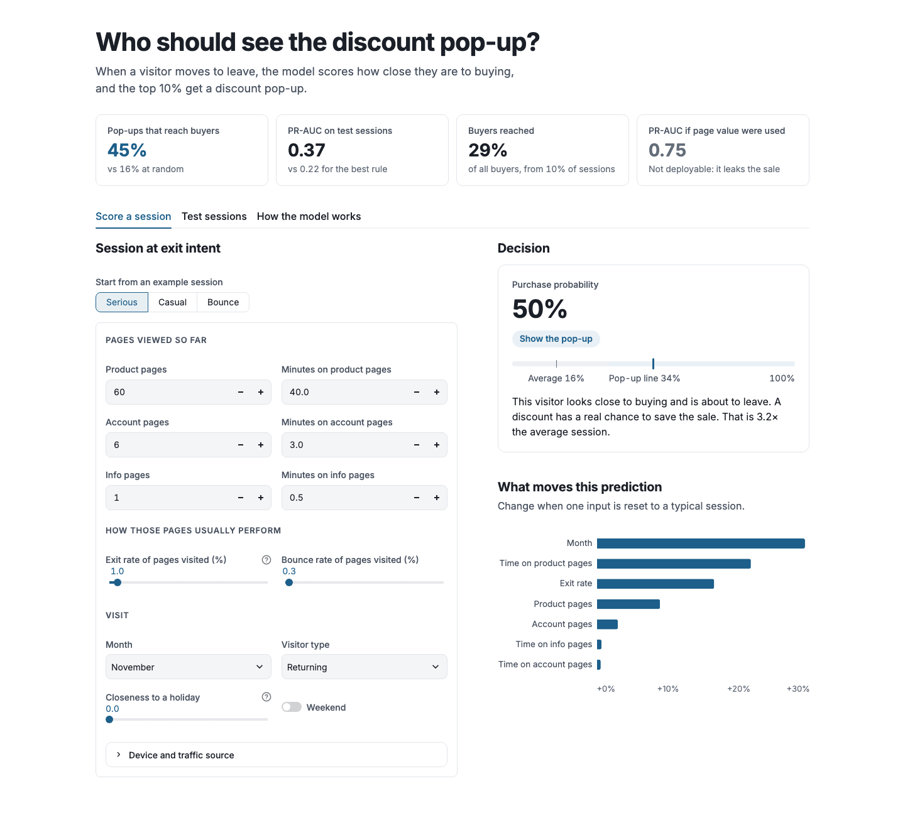
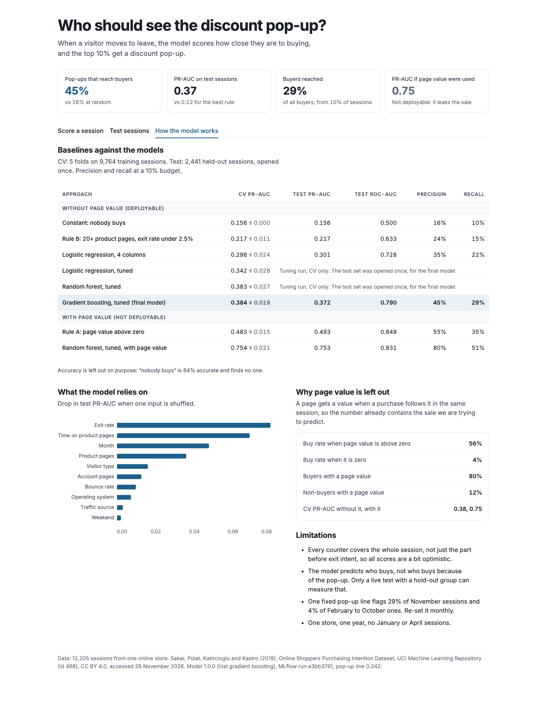

# 1. Recommendation

Run the model as a limited pilot that picks who gets the exit-intent discount pop-up, and hold back 10% of the
flagged visitors as a control group. On 2,441 sessions it never saw, the model sends 45% of its pop-ups to visitors who
really buy. A random pick reaches 16% and the best simple rule reaches 24%, so the same pop-up budget lands on almost three
times as many buyers. A second version that also uses Google Analytics "page value" looks far better (PR-AUC 0.75 against
0.37), but page value is partly made from the purchase itself and is not known yet when the visitor moves to leave. That
version should not be deployed. Two conditions come with the pilot. The pop-up line must be re-set every month, because
a fixed line would flag 21% of holiday sessions and only 4% of spring ones. The control group must also show that
pop-ups create sales and not just discounts, and if it does not, the pop-up should stop.

# 2. Problem and charter

An online store's marketing system can show a discount pop-up when a visitor shows exit intent, which means the
cursor heads for the close or back button. Showing it to everyone annoys shoppers and gives away margin. Showing it to
nobody lets close-to-buying visitors walk away. The decision owner is the e-commerce marketing manager, who caps pop-ups
at 10% of sessions. A false positive is a pop-up shown to someone who was not going to buy (an annoyed visitor and a
wasted slot). A false negative is a close-to-buying visitor who leaves without an offer (a missed save).

The model predicts, for each session, the probability that it ends in a purchase (`Revenue`). One row is one browsing
session, scored once at exit intent. The charter ([CHARTER.md](../CHARTER.md)) was committed before any model was
trained. It set three offline criteria on the held-out sessions. PR-AUC had to be at least 0.30. Precision at a 10% pop-up
rate had to be at least 0.35, more than twice the 15.6% base rate. The model also had to beat the best rule without page
value by at least 0.05 PR-AUC. The kill criteria were failing to beat that rule on PR-AUC and precision, or meeting the
targets only with page value.

The charter also asked whether this is an ML problem at all. With page value, a one-line rule ("page value above zero")
already reaches PR-AUC 0.49, and a rule would probably be enough. Without it, no single column separates buyers well, and a
10% cap needs a ranking of every session. That is where a model earns its place.

# 3. Data

The data is the UCI Online Shoppers Purchasing Intention Dataset (id 468) from Sakar et al. (2019), published under
CC BY 4.0. It was downloaded on 26 November 2026 and frozen with MD5 `cc6ec1db03b4f10f8de52c56ff48b085`. Every MLflow run
logs that hash, and `src/data.py` refuses a file with a different one. The file has 12,330 sessions from one store over
one year and 18 columns. There are no missing values. There are 125 exact duplicates, all one- or two-page bounces, and
they were dropped before splitting so that no row sits on both sides. That leaves 12,205 sessions, and 15.6% of them buy.
June is written "June" while every other month has three letters, and January and April are missing. The operating
system, browser, region and traffic-source columns are integer codes that are really categories.

**Point-in-time audit.** Each column was checked against the decision moment. Page counts and durations build up during
the session, so they are known at exit intent. Bounce and exit rates are averages from other visitors' past traffic.
Month, weekend, holiday closeness and visitor type are known from the start. One limitation applies to every counter.
The file stores whole-session totals, and a buying session's totals include its checkout clicks, so all offline scores
are a little optimistic, for the baselines too.

**The leakage suspect.** `PageValues` is far stronger than anything else. Sessions with a page value above zero buy 56%
of the time, against 4% for the rest. On its own it reaches PR-AUC 0.62, while the next best single column, exit rate,
reaches 0.26. Google Analytics gives a page value to pages viewed before a purchase in the same session. So a buying
session's own purchase feeds its own page value. Three numbers back this up. About 80% of buyers have a page value but
only 12% of non-buyers do. Among sessions that have one, buyers' median value is about twice that of non-buyers. Adding
the column lifts the best CV PR-AUC from 0.38 to 0.75. A page value could be used honestly only if the site looked up
values computed from earlier purchases, and this file has no page IDs or dates to build that. **Decision:** both versions
are trained and tracked, and only the one without page value is deployable.

**Split.** Stratified random 80/20 (9,764 training and 2,441 test sessions). There are no dates and every session is a
different user, so a time split or a grouped split is not possible. Because the holiday season looks so different, a
second check trains on February to October and tests on November and December.

# 4. Preparation and features

Everything sits inside one scikit-learn `Pipeline` in `src/features.py`, fitted only on training rows in each CV fold.
The same saved pipeline runs in the API and the app, so no preprocessing is copied anywhere. Counts and durations are very
skewed (one session spent almost 18 hours on product pages), so they get a `log1p` transform and scaling. The outliers
are real, so they are kept. Four features are built from the session's own counters: total pages, total time, the share
of pages that are product pages, and seconds per product page. The codes and the month are one-hot encoded, and codes
with fewer than 30 training sessions are pooled into one "infrequent" column. A code never seen before is ignored instead
of crashing the API.

The data also had some surprises. New visitors buy more often than returning ones (25% against 14%). November has a 25%
buy rate and a quarter of all sessions, while February is under 2%. That made me expect the season to be the biggest risk
in deployment, and section 6 shows it is.

# 5. Modelling

Four baselines were scored on the same folds and test rows. "Nobody buys" is 84% accurate and finds no one, which shows
why accuracy is never used here. Rule B (20 or more product pages and an exit rate under 2.5%) was written in the charter
before modelling and reaches PR-AUC 0.22. A logistic regression on four obvious columns reaches 0.30.

Three model families were tuned with `GridSearchCV` (stratified 5-fold, PR-AUC as the score) on the training sessions
only. They were a regularised logistic regression (6 values of C), histogram gradient boosting (16 settings) and a random
forest (8 settings). Each family was tuned twice, once without page value and once with it.

| Approach | Page value | CV PR-AUC | Test PR-AUC | Test ROC-AUC | Precision at 10% | Recall at 10% |
|---|---|---|---|---|---|---|
| Constant "nobody buys" | no | 0.156 ± 0.000 | 0.156 | 0.500 | 16% | 10% |
| Rule B: products and low exit | no | 0.217 ± 0.011 | 0.217 | 0.633 | 24% | 15% |
| Logistic regression, 4 columns | no | 0.298 ± 0.024 | 0.301 | 0.728 | 35% | 22% |
| Logistic regression, tuned (C = 0.03) | no | 0.342 ± 0.028 | | | | |
| Random forest, tuned | no | 0.383 ± 0.027 | | | | |
| **Gradient boosting, tuned (final)** | **no** | **0.384 ± 0.019** | **0.372** | **0.790** | **45%** | **29%** |
| Rule A: page value above zero | yes | 0.483 ± 0.015 | 0.493 | 0.849 | 55% | 35% |
| Random forest, tuned, with page value | yes | 0.754 ± 0.021 | 0.753 | 0.931 | 80% | 51% |

Without page value, gradient boosting and the random forest tie at about 0.38. The fold spread (±0.02 to ±0.03) is
as large as the gap between them, so the choice is close. Gradient boosting was picked on its CV mean and its smaller
spread (learning rate 0.03, depth 6, 150 iterations, L2 penalty 1.0). Both tree models beat the tuned logistic
regression, which suggests the signal has interactions, such as long product browsing paired with a low exit rate. The
test set was opened once, after this choice. The CV estimate (0.384) and the test score (0.372) agree.

# 6. Evaluation and error analysis

**Metric and operating point.** The marketing team can only show 10% of sessions a pop-up, so the headline metric is
precision at that budget, with PR-AUC as the overall ranking score. The threshold (0.342) is the 90th percentile of the
out-of-fold training scores, so it was set without touching the test set. On the test sessions it flags 11.1%, with 121
buyers and 149 non-buyers among the 270 flagged, and 261 buyers missed. Per 1,000 sessions, that is about 110 pop-ups
reaching about 50 buyers, against 16 for a random pick. With a 10% budget and a 15.6% buy rate, at most 64% of buyers
could ever be reached, so missing many is built into the budget. The capacity curve below shows precision holding
around 0.45 to 0.47 up to a 10% budget and then sliding slowly, to about 0.38 at 20%. Calibration is good (Brier score 0.113), so the app can show
the probability as a plain number. The model rarely goes above 0.6. It is good at "more likely than average", which is
all a ranking needs.

**Charter check.** PR-AUC 0.372 (target 0.30), precision 0.451 at 10% (target 0.35) and +0.155 PR-AUC over Rule B
(target +0.05). Every criterion is met, and neither kill criterion fires.

**Slices.** Slices use every session scored by a model that never saw it (out-of-fold for training rows, the final
model for test rows). The biggest finding is the season. With one fixed line, 29% of November sessions are flagged and
only 4% of February to October sessions, and February gets none. Precision stays similar (0.46 against 0.40), so the
model is not worse in spring. It just finds fewer sessions over the line. In practice that blows the budget in November
and under-uses it in spring, so the line must be re-set monthly. New visitors are flagged more often than returning ones
(23% against 8%) because they buy more often, and their precision is 0.45, so the charter's guardrail holds. July (12
flags, precision 0.17) and traffic source 13 (6% buy rate) are the weakest slices, but both are small. Weekends make
little difference. The month check, trained on February to October and tested on November and December, gives PR-AUC
0.335 against 0.286 for Rule B. The model degrades but still beats the rule.

**What the model uses.** Permutation importance on the test set puts exit rate first, then time on product pages, the
month and the product page count. In the comparison model with page value, shuffling page value alone drops PR-AUC by
0.53 and everything else almost vanishes. That model is mostly a page-value lookup.

# 7. Experiment tracking

All runs live in one MLflow experiment, `online-shoppers-popup`, with a SQLite backend. `python src/train.py` logs 15
runs: four baselines, six tuning runs (three families times two feature sets), the PageValues leakage check, the final
model, the with-page-value comparison, the month check and the drift check. Each run has a `kind` and a `feature_set` tag,
the data MD5 and the git commit. It also stores parameters, CV mean, standard deviation and per-fold PR-AUC, test metrics,
and artifacts such as the grid results, slices, figures and metadata. The final run (`a3bb379198604ce29b251049a71c2de3`)
is registered as `shoppers-popup-purchase` version 1 with the alias `champion`. It reloads with
`mlflow.sklearn.load_model("models:/shoppers-popup-purchase@champion")`. Notebook 02 reads its tables straight from the
tracker.

# 8. Deployment

The full pipeline is saved as `models/model.joblib`, with `models/model.json` beside it. The metadata holds the version,
training date, row counts, data hash, git commit, run ID, features, the excluded column, threshold, test metrics and
library versions. `train.py` reloads the file and asserts the predictions match before saving. A FastAPI service
(`app/api.py`) loads the artifact once at startup. It exposes `GET /health` and `POST /predict`. The input is a Pydantic
schema with ranges, allowed months and visitor types, and `extra = "forbid"`, so a request that sends `PageValues` gets a
422 instead of being quietly ignored. A sample response is `{"purchase_probability": 0.3872, "show_popup": true,
"threshold": 0.3423, ...}`. The Streamlit app (`app/ui.py`) loads the same artifact through `src/predict.py`, so it can
run on Streamlit Community Cloud without the API. It has three tabs. The first scores a session and shows the decision
and what moved it. The second ranks the held-out sessions under an adjustable pop-up budget. The third explains the model
and the page-value decision. One Dockerfile serves both. `docker compose up --build` starts the API on port 8000 and the
app on 8501, and both were tested from the built images. 23 pytest tests cover features, evaluation helpers, the saved
model, the API (including invalid input) and the app.

# 9. Monitoring

The runbook ([MONITORING.md](../MONITORING.md)) has six checks, each with an owner. API errors and latency are watched
continuously (alarm at p95 above 200 ms). Schema and new codes are checked daily. PSI on the top inputs and on the score
is checked weekly (alarm above 0.25). The pop-up rate is checked daily (alarm outside 7% to 13%). The realised value is
read weekly from a hold-out group that never sees pop-ups. Discount cost is reviewed monthly. Labels arrive quickly but
are changed by the pop-up itself, which is why the hold-out group matters. The drift job in `train.py` is the template.
Train against test is stable (largest PSI 0.01). A simulated holiday shift fires on traffic source (0.81), holiday
closeness (0.78) and the score (0.35), and it would push the flag rate from 4% to 21%. Retraining is quarterly and
before each holiday season. Rollback to the previous `champion` happens if a new version's first-day flag rate is outside
the band or its hold-out results are worse.

# 10. Limitations, ethics and next steps

The biggest limitation is that the model predicts who will buy, not who will buy *because of* the pop-up. Some flagged
visitors would have bought anyway, and for them the discount is lost margin. Only the hold-out group can measure the real
lift, and an uplift model would be the next step once that data exists. The counters are whole-session totals, so live
scores at exit intent will be a little weaker than these. The data covers one store, one year, and no January or April.
The best next step for accuracy is a real-time page-value lookup built from the previous month's purchases. The
comparison model suggests that it could add a lot, and it would be point-in-time correct.

On ethics, the dataset holds no personal data, and no protected attribute is used. The main harm is unequal treatment.
New visitors and holiday shoppers get more discounts, and returning visitors in quiet months get almost none. That is a
pricing-fairness question the marketing manager should decide on purpose. The model should not decide it by accident.
Visitors who are annoyed by pop-ups carry the cost of false positives, which is why the 10% cap matters.

**Tools.** I wrote and verified all code, analysis and numbers myself. An AI assistant was used for minor editing
and debugging; every figure was re-run from the MLflow logs.

**Reference.** Sakar, C. O., Polat, S. O., Katircioglu, M., & Kastro, Y. (2019). Real-time prediction of online
shoppers' purchasing intention using multilayer perceptron and LSTM recurrent neural networks. *Neural Computing and
Applications, 31*, 6893-6908. https://doi.org/10.1007/s00521-018-3523-0
