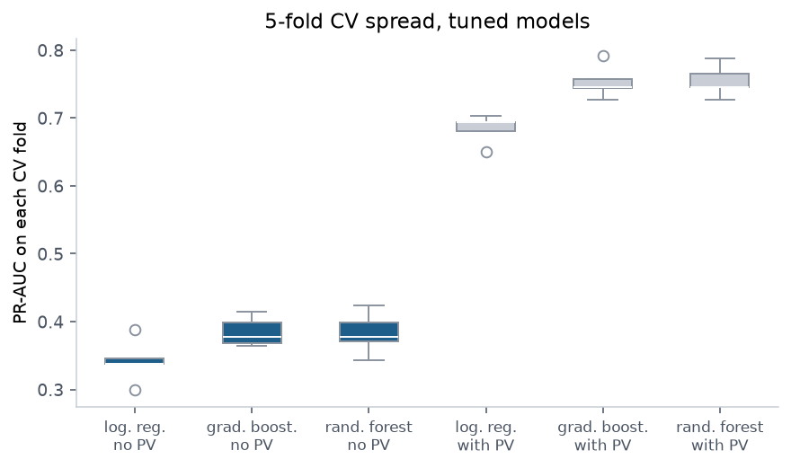

# Slides: 10-minute talk with a live demo

Each slide shows one idea. The line after **Slide N** is all that appears on screen, and *small:* is the one supporting
line under it. **Say** is what you say out loud. The PDF version is `reports/slides.pdf`. Timings add up to about
10 minutes, with 2.5 minutes for the demo.

Before the talk: run `streamlit run app/ui.py` (or open the Streamlit Cloud link) and keep the tab ready on
"Score a session". Have `http://127.0.0.1:8000/docs` open in a second tab in case someone asks about the API.

---

**Slide 1** · Who should see the discount pop-up?
*small:* Predicting purchase intent for online shoppers · Sanskriti Acharya · 27 November 2026

**Say (25 s):** When you move to close a shopping tab, some stores show a discount pop-up. My project asks one
question. Which visitors should get it?

---

**Slide 2** · 10% of sessions
*small:* The most that can get a pop-up. Owner: the e-commerce marketing manager.

**Say (45 s):** The decision happens at exit intent, the moment the visitor moves to leave. The marketing manager
owns it, and they cap pop-ups at 10% of sessions, because more annoys shoppers and gives away margin. A false
positive is a pop-up for someone who was never going to buy. A false negative is a close-to-buying visitor who leaves
with no offer. I wrote the success and kill criteria in the charter before training anything.

---

**Slide 3** · 15.6% buy
*small:* "Nobody buys" is 84% accurate, and useless.

**Say (35 s):** The data is the UCI Online Shoppers dataset, 12,330 sessions from one store over a year. I dropped 125
duplicates, which leaves 12,205 sessions. Only 15.6% end in a purchase. That is why I never use accuracy. My main numbers
are PR-AUC and precision at the 10% budget, meaning the share of pop-ups that reach real buyers.

---

**Slide 4** · 56% vs 4%
*small:* Buy rate when page value is above zero, and when it is zero.

**Say (40 s):** One column looked too good. Page value is a Google Analytics number. When it is above zero, 56% of
sessions buy. When it is zero, 4% do. On its own it beats every model I built on all the other columns. The course rule
is that when something looks too good, the first job is to find out why.

---

**Slide 5** · Page value contains the purchase
*small:* Google Analytics credits a page with purchases that come after it, in the same session.

**Say (40 s):** So when a session buys, its own purchase pushes up the value of the pages it just saw. 80% of buyers
have a page value and only 12% of non-buyers do. At exit intent the purchase has not happened yet, so the number does not
exist in that form. The only honest version would be a lookup built from last month's purchases, and this file has no
page IDs or dates to build it.

---

**Slide 6** · One column beats every algorithm
*small:* CV PR-AUC on each fold. Blue: no page value. Grey: with it.

**Say (40 s):** I tuned three families, logistic regression, gradient boosting and random forest, with and without page
value, all in 5-fold CV. Without it, the trees tie at about 0.38. With it, everything jumps to about 0.75. The gap from
one column is ten times the gap between algorithms. Both versions are logged in MLflow, and only the one without page
value is deployable.

---

**Slide 7** · 16% · 24% · 35% · 45%
*small:* Pop-ups that reach buyers: random, best rule, simple model, final model.

**Say (45 s):** These are on 2,441 test sessions the model never saw, opened once at the end. A random 10% reaches 16%
buyers. The best rule I wrote in the charter, many product pages and a low exit rate, reaches 24%. A four-column logistic
regression reaches 35%. The tuned gradient boosting model reaches 45%. That beats every charter target: PR-AUC 0.37 against
a target of 0.30, and precision 0.45 against 0.35.

---

**Slide 8** · Live demo

**Say (2 min 30 s), demo script:**

1. *Score a session tab, "Serious" example.* "This is a returning visitor in November with 60 product pages and 40
   minutes on them. The model says 50%, three times the average, so it shows the pop-up. On the right you can see what
   moved it: the month, time on product pages and the exit rate."
2. *Click "Bounce".* "Two pages, high exit rate. Under 1%. No pop-up."
3. *Back to "Serious", change Month to May.* "The same visitor in May drops to 20%, under the pop-up line. The
   season matters a lot, and I will come back to that."
4. *Test sessions tab.* "These are the held-out sessions ranked by the model. At a 10% budget, 244 pop-ups, 110 go to
   buyers, against 38 at random." *Drag the budget to 20%.* "Precision falls to 39% as the budget grows, which is why
   10% is a sensible cap."
5. *How the model works tab.* "Every baseline and model, with and without page value, and why page value is out."

If the app is slow, show `reports/screenshots/streamlit_score_desktop.png` instead.

---

**Slide 9** · 29% in November. 4% in spring.
*small:* Share of sessions over one fixed pop-up line.

**Say (35 s):** This is the most useful thing the error analysis found. With one fixed line, the model flags 29% of
November sessions and 4% in spring. Precision stays about the same, so the model is not wrong. It just finds more
buyers in November. But it would blow the 10% budget, so the line has to be re-set every month. A PSI check on the holiday
months fires on traffic source and on the score itself, so this would be caught in the first week.

---

**Slide 10** · Who buys *because of* the pop-up?
*small:* The data cannot tell. A hold-out group can.

**Say (35 s):** The honest limit. My model predicts who buys, not who buys because of the discount. Some flagged visitors
would have bought anyway, and their discount is lost margin. So the monitoring plan holds back 10% of flagged visitors
with no pop-up. If they buy just as often, the pop-up is not working and should stop. That is a kill criterion from the
charter.

---

**Slide 11** · Pilot it, with a hold-out group
*small:* Without page value. Re-set the line monthly. Stop if the hold-out group buys just as often.

**Say (35 s):** My recommendation is a pilot. Use the model without page value. It sends almost three times as many
pop-ups to real buyers as a random pick. Re-set the pop-up line every month, and keep a hold-out group to prove the
pop-up adds sales. Everything is tracked in MLflow, served by FastAPI and Streamlit, and runs in Docker from a clean
clone. Thank you.

---

**Slide 12** · Questions

**Say:** Likely questions and short answers:

* *Why not use page value if it is so strong?* It is partly built from the purchase itself, and it is not known at
  exit intent. A frozen lookup from last month's purchases would be the honest version.
* *Why a random split, not by time?* There are no dates, only months, and each session is a different user. The
  month check (train Feb to Oct, test Nov to Dec) still beats the rule, 0.34 against 0.29.
* *Why gradient boosting over random forest?* They tie within the fold spread. Gradient boosting had the higher CV mean
  and the smaller spread.
* *Is 45% good?* It is 2.9 times random and nearly double the best rule. At most 64% of buyers could be reached with a
  10% budget, so recall is capped by the budget.
